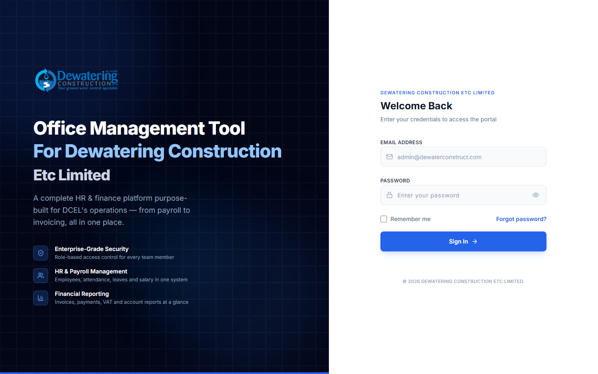
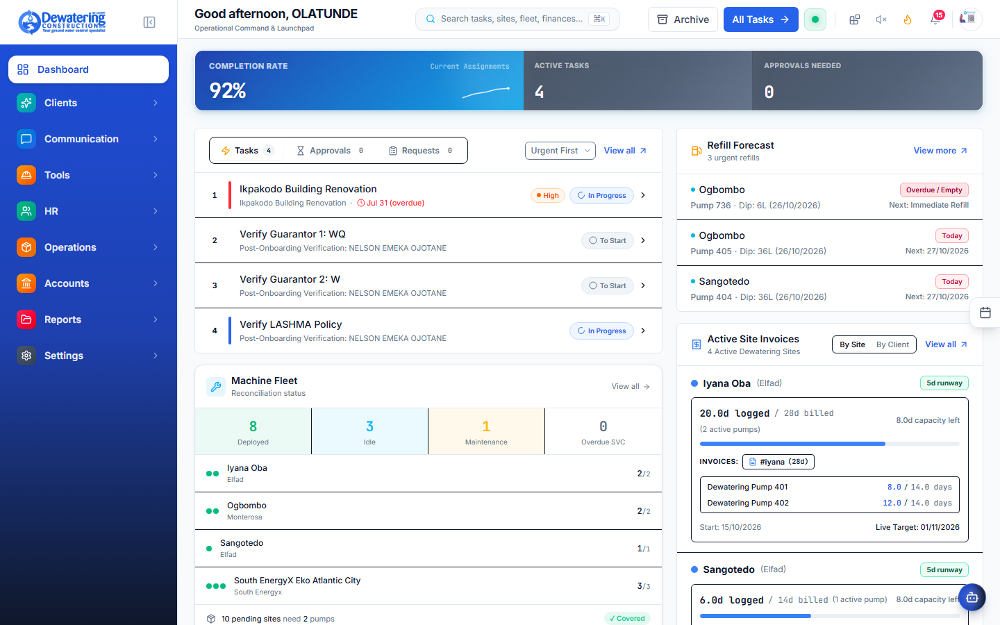

# Chapter 1: Getting Started & Using the App

> **Company:** Dewatering Construction Etc. Limited (DCEL)  
> **Who is this for?** Every employee using the app on a phone, laptop, or office PC  

---

## 1.1 How to Open the App

You can access DCEL Office Suite in three simple ways depending on where you are working:

1. **On Any Office Computer or Laptop (Web Browser):**  
   Open Google Chrome or Microsoft Edge and go to your company link (e.g. `https://dcel.office.com`).
2. **On Your Work Desktop (Desktop App):**  
   Double-click the **DCEL Office Suite** icon on your Windows computer desktop.
3. **On Your Smartphone or Tablet (Mobile App):**  
   Tap the **DCEL Office** app icon on your company phone or personal Android/iPhone.

---

## 1.2 How to Log In

When you open the app, you will see the **Sign In** screen.



### Steps to Sign In:
1. Type your company email address into the **Email Address** box.
2. Type your secret password into the **Password** box.
3. Click the blue **Sign In** button.
4. You will immediately be taken to your **Home** screen or **Dashboard**.

> [!TIP]
> **Forgot Your Password?**  
> Click **"Forgot your password?"** on the login screen, enter your email address, and check your inbox for a reset link. If you do not receive it within 5 minutes, ask your HR manager to issue a temporary password for you.

---

## 1.3 Understanding Your Screen

Once logged in, the screen is laid out cleanly so you never feel lost:



```
┌─────────────────────────────────────────────────────────────────────────────┐
│ [DCEL Logo]   [ 🔍 Search Ctrl+/ ]              [ 🌙 Night Mode ] [ 👤 Profile ] │
├───────────────┬─────────────────────────────────────────────────────────────┤
│ DEPARTMENTS   │ WHERE YOU ARE: Home > Human Resources > Daily Attendance    │
│               ├─────────────────────────────────────────────────────────────┤
│ 🏠 Dashboard  │                                                             │
│ 🏢 Clients    │   [ + Mark Attendance ]     Date: [ Today, Oct 27, 2026 ]   │
│ 💬 Comms      │                                                             │
│ 🛠️ Tools      │   Worker Name       | Shift | Present | Site Location       │
│ 👥 HR         │   ──────────────────┼───────┼─────────┼───────────────────  │
│ 📦 Operations │   Musa Ibrahim      | Day   | [x] Yes | Eko Atlantic Site   │
│ 💰 Accounts   │   Chinedu Eze       | Night | [x] Yes | Dangote Site        │
│ 📁 Reports    │                                                             │
│ ⚙️ Settings   │                                                             │
└───────────────┴─────────────────────────────────────────────────────────────┘
```

### The 4 Main Areas of the Screen:
1. **The Left Sidebar Menu (Departments):**  
   Lists the main parts of the company: Dashboard, Clients, Communication, Tools, HR, Operations, Accounts, Reports, and Settings. Click any one to open its tools.
2. **The Top Bar:**  
   - **Search Bar (`Ctrl + /`):** Instantly find any worker, tool, site, or invoice by typing a name or number.
   - **Night Mode Toggle (Moon/Sun):** Switch between bright white and soft dark colors for easy reading at night.
   - **Profile Icon:** Click your photo or name at the top right to view your account details or sign out.
3. **The Breadcrumb Trail (Top of the page):**  
   Shows you exactly where you are inside the app (for example: `Home > Operations > Equipment`). You can click any word in that line to jump back.
4. **The Working Area (Center of the screen):**  
   Where your work happens—whether you are checking a site register, typing an invoice, or viewing a machine checklist.

---

## 1.4 How to Change Your Password & Update Your Profile

1. Click your name or profile circle in the top right corner.
2. Select **Account Settings**.
3. To change your password:
   - Type your **Current Password**.
   - Type your **New Password** (use at least 8 letters and numbers).
   - Click **Save Password**.
4. You can also verify that your mobile phone number and job title are spelled correctly.
