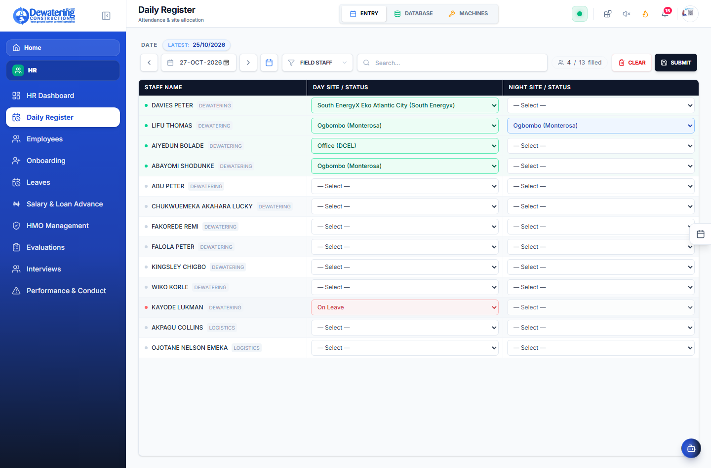
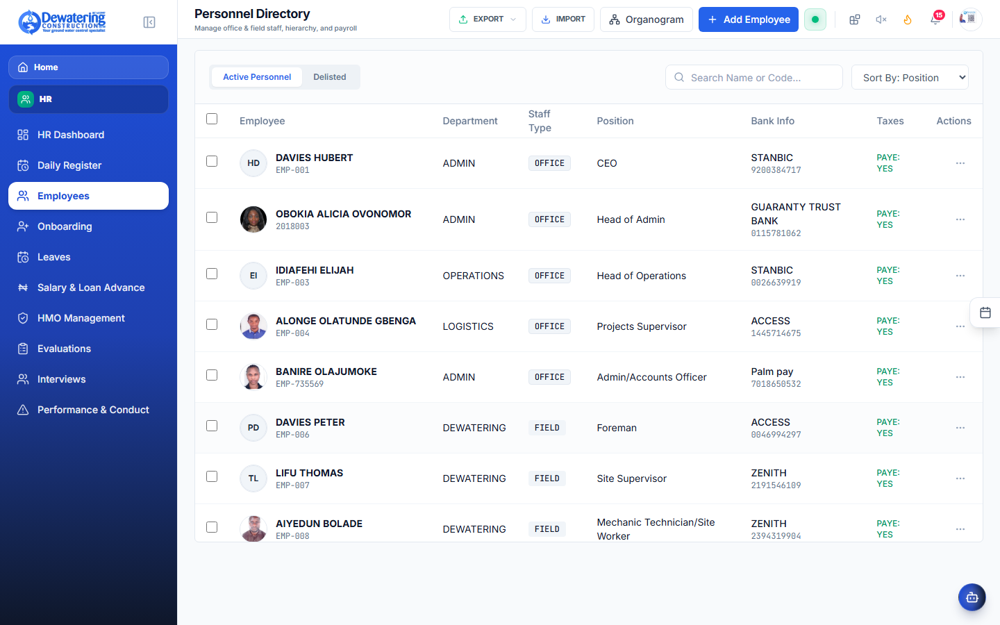
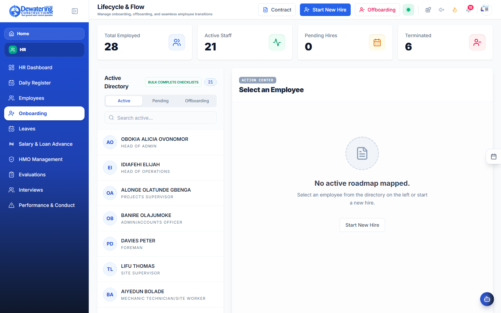
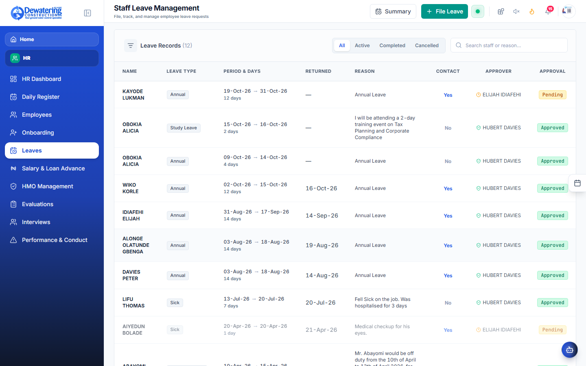
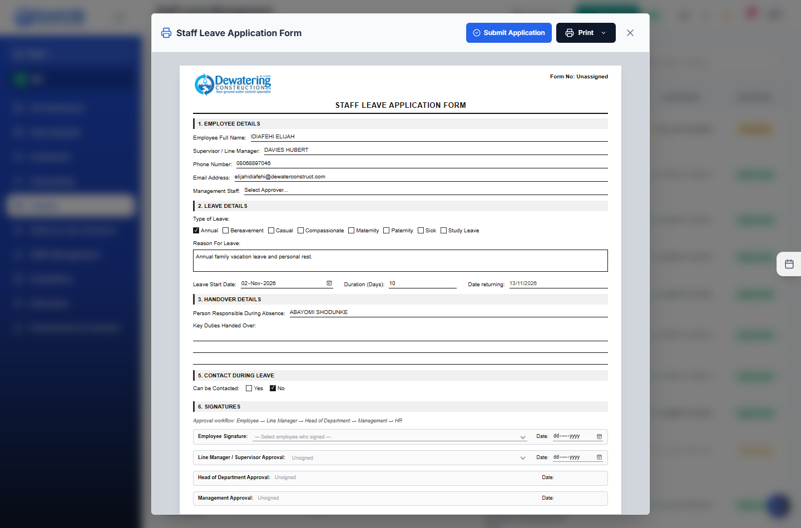
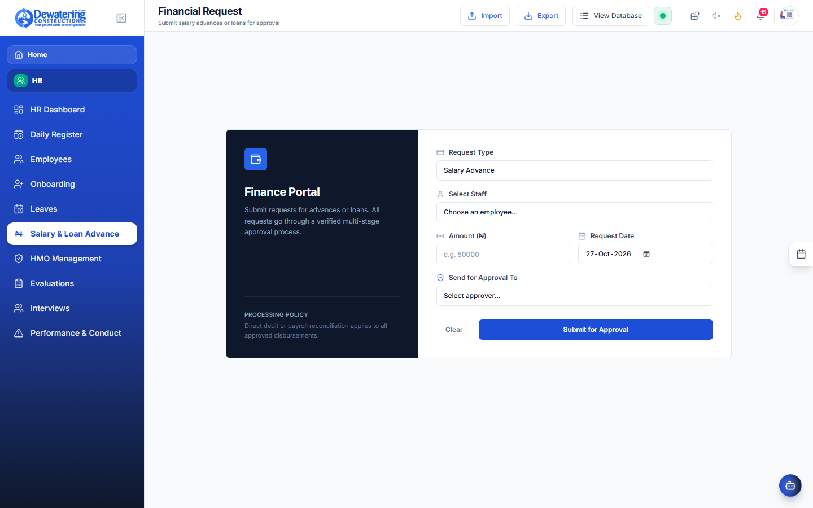
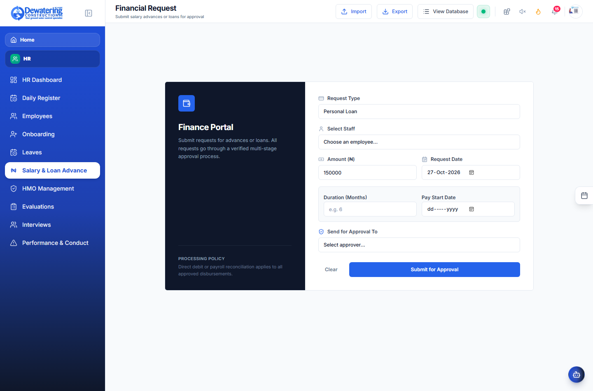
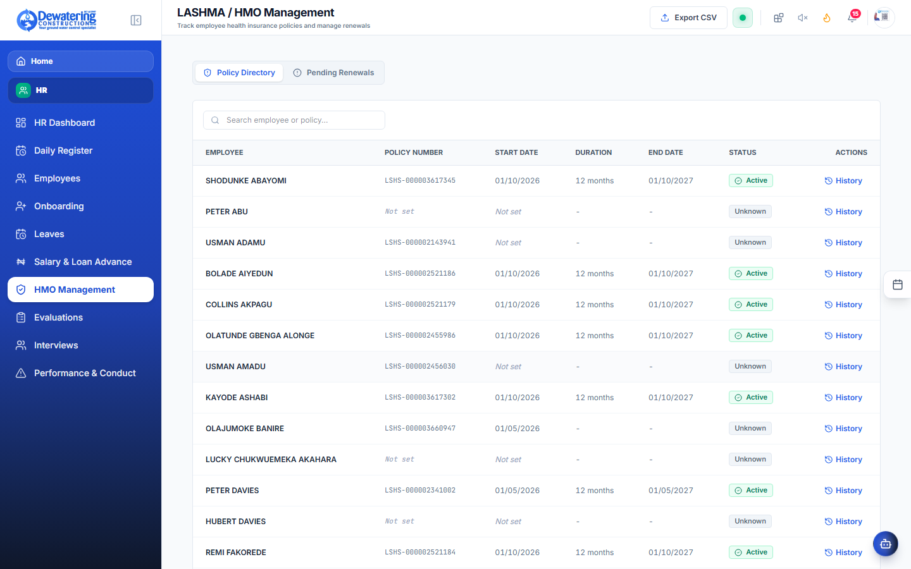

# Chapter 2: Human Resources & Staff Management

> **Company:** Dewatering Construction Etc. Limited (DCEL)  
> **Who is this for?** Site Foremen, HR Officers, Department Managers, and All Employees  

---

## 2.1 Daily Site Attendance (How to Mark the Daily Register)

**Where to go:** In the left menu, click **HR** ➔ **Daily Register** (`/attendance`)

The Daily Register records which workers were on duty each day. The system uses this exact information at the end of the month to calculate salaries and overtime pay.

### What the Columns Mean:
- **Present:** Check the box if the worker reported to work. Leave it unchecked if absent.
- **Day Site / Night Site:** Choose the site where the worker was stationed from the dropdown menu (e.g., *Eko Atlantic*, *Dangote*, *Lekki Phase 1*, or *Head Office*).
- **Shift:** Choose whether they worked the **Day**, **Night**, or **Both** (Double Shift).
- **OT (Overtime):** Number of extra hours worked beyond their normal shift. Working on Sundays or public holidays automatically counts towards overtime pay.
- **Next Day? (NDW):** Check this box if the worker is scheduled to work again tomorrow so the site supervisor knows they are returning.

### Step-by-Step: How to Fill the Register
1. Go to **HR** ➔ **Daily Register**.
2. Select the date using the date box at the top.
3. Check the **Present** box for each worker who is on site today.
4. Select their site location.
5. If someone worked extra hours, type the hours into the **OT** box.
6. Click the blue **Save Attendance** button at the bottom of the page.

---

## 2.2 Finding Workers in the Employee Directory

**Where to go:** In the left menu, click **HR** ➔ **Employees** (`/employees`)

Need to call a technician, check an emergency contact, or look up bank details?

### How To: Search for a Colleague
1. Go to **HR** ➔ **Employees**.
2. Type any part of their name or job title into the search box.
3. Click on the worker’s name to open their profile.
4. You can see their:
   - Phone number and email
   - Emergency contact person (next of kin)
   - Job title and department
   - Bank account number (restricted to HR & Accounts)

---

## 2.3 How to Onboard a New Worker & Print Their Contract

**Where to go:** In the left menu, click **HR** ➔ **Onboarding** (`/onboarding`)

When a new engineer, mechanic, or site technician joins the company:

### Step 1: Add Their Details
1. Click **+ Register New Hire**.
2. Type in their full legal name, phone number, address, and date of birth.
3. Select their job title, department, and starting monthly salary.
4. Upload a copy of their photo ID, resume, and medical fitness form.
5. Click **Save New Employee**.

### Step 2: Generate Their Official Employment Contract
1. In the onboarding menu, click **Generate Contract**.
2. Select the worker's name.
3. Choose the contract template (e.g. *Full-Time Staff Contract* or *Site Technician Agreement*).
4. The system automatically types in their name, salary in words, job title, and company rules.
5. Click **Download / Print PDF** to give to the worker to sign.

---

## 2.4 How to Apply for Vacation or Sick Leave

**Where to go:** In the left menu, click **HR** ➔ **Leaves** (`/leaves`)

Every full-time staff member is entitled to annual paid leave, plus sick leave and emergency leave when needed.

### Official Staff Leave Application Form (Interactive Form Modal)

Clicking **+ File Leave** opens the official DCEL Staff Leave Application Form:

### Step-by-Step: Submitting Your Leave Request
1. Go to **HR** ➔ **Leaves** and click **+ Request Leave**.
2. Select the **Leave Type** (Annual Vacation, Sick Leave, Maternity/Paternity, or Compassionate).
3. Pick your **Start Date** and **End Date**. The app automatically calculates how many working days you are taking (it does not count weekends or holidays).
4. Choose a coworker as your **Relieving Staff** who will handle your urgent duties while you are away.
5. Click **Submit Leave Request**.
6. Your manager will get an alert to approve your request. Once approved, the attendance sheet will automatically mark you as "On Leave."

---

## 2.5 Salary Advances & Emergency Loans

**Where to go:** In the left menu, click **HR** ➔ **Salary & Loans** (`/salary-loans`)

If an employee needs an emergency advance or personal loan from the company:

### Finance Portal & Loan Application Form

1. Click **+ Apply for Loan**.
2. Select the worker's name.
3. Enter the total loan amount requested (e.g. ₦100,000).
4. Choose the monthly deduction (e.g. ₦25,000 per month for 4 months).
5. Once HR and Finance approve the loan, the payroll system will automatically deduct ₦25,000 each month until the full amount is repaid.

---

## 2.6 Health Insurance (HMO) & Hospital Care

**Where to go:** In the left menu, click **HR** ➔ **HMO Management** (`/hmo`)

Dewatering Construction Etc. Limited provides health insurance for staff and their families.

### What You Can Do Here:
- **View Your Hospital Plan:** See whether you are on the Executive, Senior, or Site Operative plan and find which private hospitals in your city are covered.
- **Add Dependents:** Register your spouse and children with their names and birth certificates so they can receive hospital care under your plan.

---

## 2.7 Recruitment & Automatic Resume Reading

**Where to go:** In the left menu, click **HR** ➔ **Interviews** (`/interviews`)

When hiring new site engineers or technicians:
1. Drag and drop any applicant's PDF resume directly onto the screen.
2. The system reads the resume automatically, filling in the applicant's name, years of dewatering or civil experience, past employers, and qualifications.
3. Click **Schedule Interview** to book a date with the candidate.
