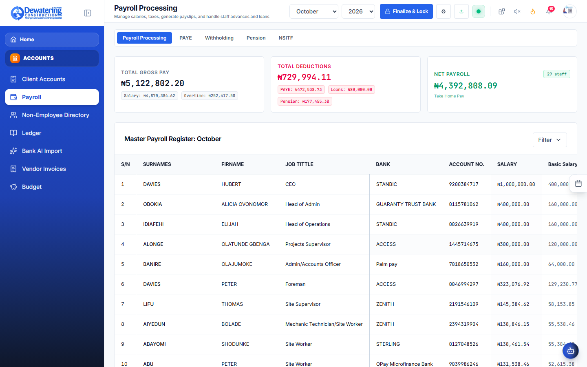
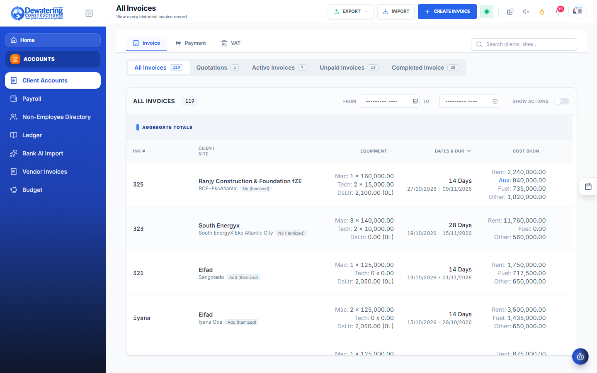
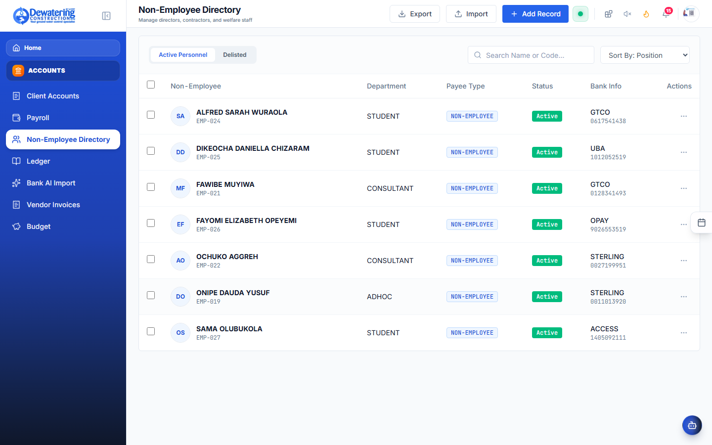
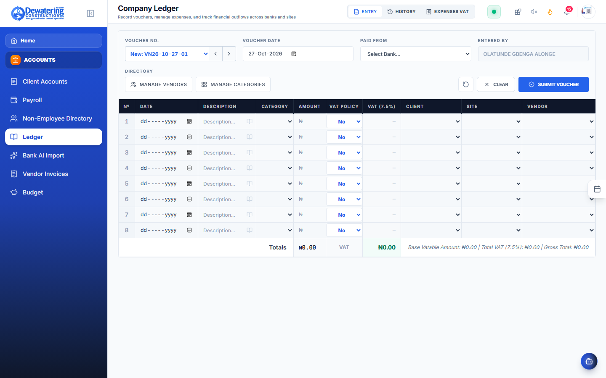
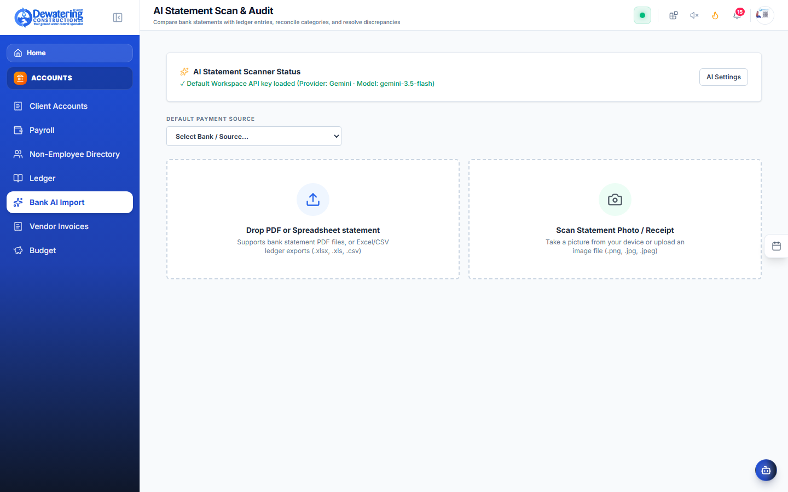

# Chapter 3: Finance, Payroll & Invoicing

> **Company:** Dewatering Construction Etc. Limited (DCEL)  
> **Who is this for?** Accountants, Billing Officers, Site Supervisors submitting expenses, and Staff checking their payslips  

---

## 3.1 Understanding How Monthly Payroll Works

**Where to go:** In the left menu, click **Accounts** ➔ **Payroll** (`/payroll`)

The payroll system in DCEL Office Suite does all the math automatically at the end of every month. It combines employee salary agreements with daily attendance records.

### How an Employee's Pay Is Calculated:

```
   [ Base Salary (pro-rated by days worked) ]
+  [ Allowances: Housing, Transport, Utility ]
+  [ Overtime Earnings (Sunday shifts & extra hours) ]
─────────────────────────────────────────────────────────────
=  GROSS EARNINGS
-  [ Pension Savings (8% saved for your retirement) ]
-  [ PAYE Income Tax (Official government tax deduction) ]
-  [ Loan Deductions (Monthly repayment on salary advance) ]
─────────────────────────────────────────────────────────────
=  FINAL NET SALARY (Cash deposited to your bank account)
```

1. **Days Worked vs Official Days:**  
   If there are 22 working days in a month, and an employee was present or on approved paid leave for all 22 days, they receive 100% of their base salary. If they missed 2 days without approval, they are paid for 20 days.
2. **Overtime Pay:**  
   Hours worked on Sundays, holidays, or emergency night shifts recorded in the Daily Register are automatically multiplied by the company overtime rate and added to the paycheck.
3. **Statutory Deductions:**  
   - **Pension (8%):** Deducted and remitted directly into your registered Pension Fund Administrator (PFA) account for your future retirement.
   - **PAYE Tax:** Calculated strictly according to official Nigerian tax regulations after applying the statutory Consolidated Relief Allowance (CRA).
4. **Loan Repayments:**  
   If you have an active salary advance, your agreed monthly installment is deducted automatically so you never have to remember to make manual payments.

---

## 3.2 Step-by-Step: How to Run the Monthly Payroll

For Accounts Officers and HR Managers:



```
┌────────────────────────────────────────────────────────────────────────────────────────┐
│ MONTHLY PAYROLL WIZARD — October 2026                                                  │
├────────────────────────────────────────────────────────────────────────────────────────┤
│ Official Working Days: [ 22 ]               Overtime Rate: [ 1.5x Daily Rate ]         │
├────────────────────────────────────────────────────────────────────────────────────────┤
│ Employee Name    │ Days │ Base Pay    │ Allowances │ Overtime │ Deductions│ Net Pay (₦)│
├──────────────────┼──────┼─────────────┼────────────┼──────────┼───────────┼────────────┤
│ Ibrahim Musa     │ 22   │ ₦250,000.00 │ ₦120,000   │ ₦18,500  │ ₦63,100   │ ₦325,400.00│
│ Samuel Okon      │ 20   │ ₦180,000.00 │ ₦80,000    │ ₦0       │ ₦38,800   │ ₦221,200.00│
│ Chinedu Eze      │ 22   │ ₦300,000.00 │ ₦150,000   │ ₦42,000  │ ₦93,200   │ ₦398,800.00│
├──────────────────┴──────┴─────────────┴────────────┴──────────┴───────────┴────────────┤
│ TOTAL MONTHLY SALARY OUTFLOW: ₦ 14,850,200.00       [ Approve & Issue Payslips ]       │
└────────────────────────────────────────────────────────────────────────────────────────┘
```

1. Go to **Accounts** ➔ **Payroll**.
2. Click **+ New Payroll Run**.
3. Select the month and year.
4. Verify the total official workdays for that month.
5. Click **Calculate Payroll**. In less than two seconds, the system pulls in all attendance logs, overtime hours, and active loans, and shows the full breakdown for every worker.
6. Check for any amber warning badges (such as someone who joined mid-month).
7. Click **Approve Payroll**.
8. Click **Export Bank Schedule** to download the payment file for your online bank portal (e.g. Access Bank, Zenith, GTBank).
9. Click **Email All Payslips** to automatically send confidential PDF payslips to each worker's inbox.

---

## 3.3 How to Create a Client Invoice

**Where to go:** In the left menu, click **Accounts** ➔ **Client Accounts** (`/client-accounts`)

When billing a client for dewatering contracts, pump rentals, or generator hire:



1. Click **+ Create Invoice**.
2. Select the **Client Name** and the **Site Location**.
3. Add the billing items:
   - Example 1: *6-inch Sykes Vacuum Pump Rental — 30 Days @ ₦120,000/day*
   - Example 2: *Wellpoint Jetting & Installation Fee — Lump sum ₦1,500,000*
   - Example 3: *Diesel Fuel Surcharge — 5,000 Liters @ ₦1,200/L*
4. The system automatically adds **7.5% VAT** and displays the **5% Withholding Tax (WHT)** deduction.
5. Click **Save & Generate Invoice**.
6. You can print the official PDF with company letterhead, signature, and bank payment instructions to send to the client.

---

## 3.4 How to Record Client Payments & Bank Transfers

When a client transfers money for an invoice:
1. Go to **Accounts** ➔ **Client Accounts**.
2. Click on the invoice number.
3. Click **+ Record Payment**.
4. Enter the amount paid, payment date, and bank reference/receipt number.
5. If the client deducted 5% Withholding Tax, check the **"WHT Deducted"** box.
6. The invoice status updates to **Paid** or **Partially Paid**, and the payment appears on the client's balance sheet.

---

## 3.5 Paying Casual Site Labor & Artisans

**Where to go:** In the left menu, click **Accounts** ➔ **Non-Employee Directory** (`/beneficiaries`)

Construction sites frequently hire temporary daily laborers, welders, or haulage truck drivers who are not full-time employees:



1. Click **+ Add Beneficiary**.
2. Type their name, phone number, and bank account details.
3. Enter the amount approved for their work.
4. Click **Create Payment Voucher**. This allows accounts to make payments directly without mixing temporary labor with full-time staff payroll.

---

## 3.6 How to Submit Site Expenses & Receipts

**Where to go:** In the left menu, click **Accounts** ➔ **General Ledger** (`/ledger`)

When a site engineer buys spare bolts, motor oil, or emergency diesel on site:



1. Click **+ Log Expense**.
2. Choose the **Site** and the **Category** (e.g. *Machine Repairs*, *Site Consumables*, *Transport*).
3. Type the amount spent.
4. Click **Attach Receipt** to take a picture of the paper receipt with your phone camera.
5. Click **Submit Expense**. The office accountant will review and reimburse the money.

---

## 3.7 Uploading Bank Statements for Automatic Matching

**Where to go:** In the left menu, click **Accounts** ➔ **Bank AI Import** (`/bank-import`)

Instead of matching dozens of bank transactions by hand:



1. Download your monthly bank statement in PDF or CSV from your bank portal.
2. Drag and drop the file onto the screen.
3. The system scans the statement, matches client deposits against pending invoices, and highlights any unmatched payments.
4. Click **Confirm Matches** to update client balances automatically.
