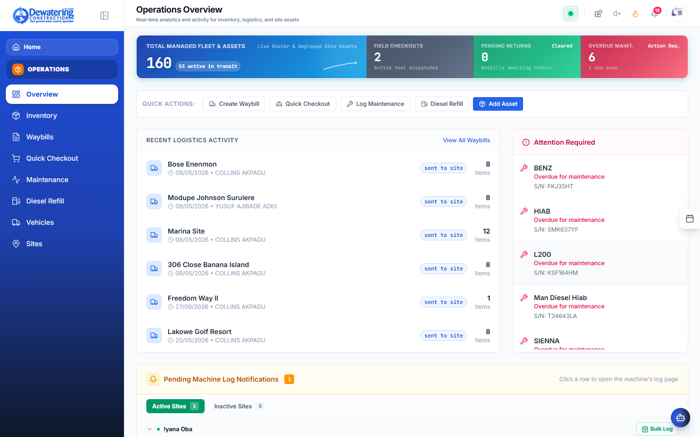
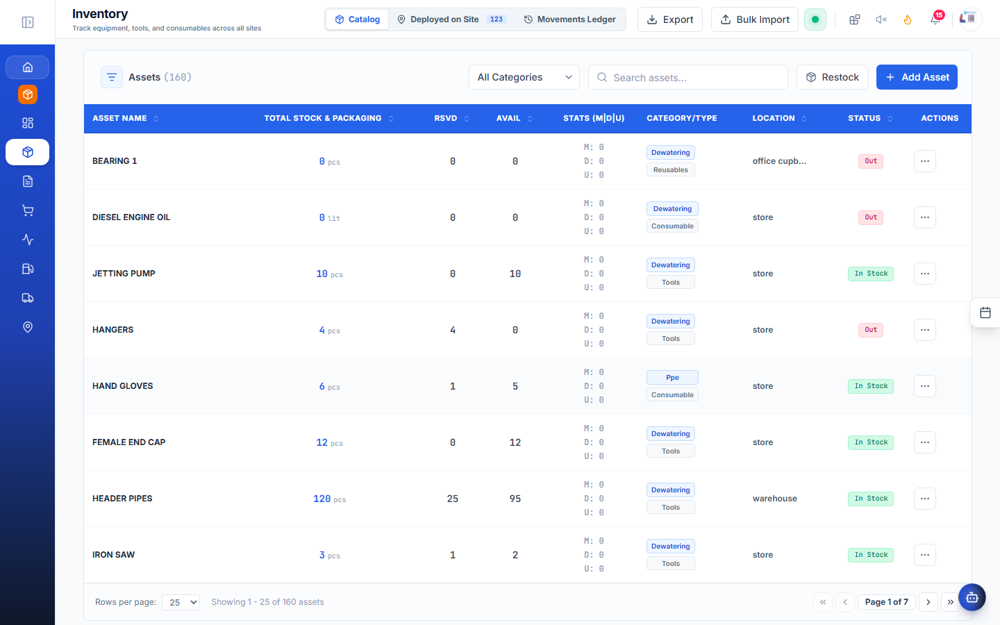
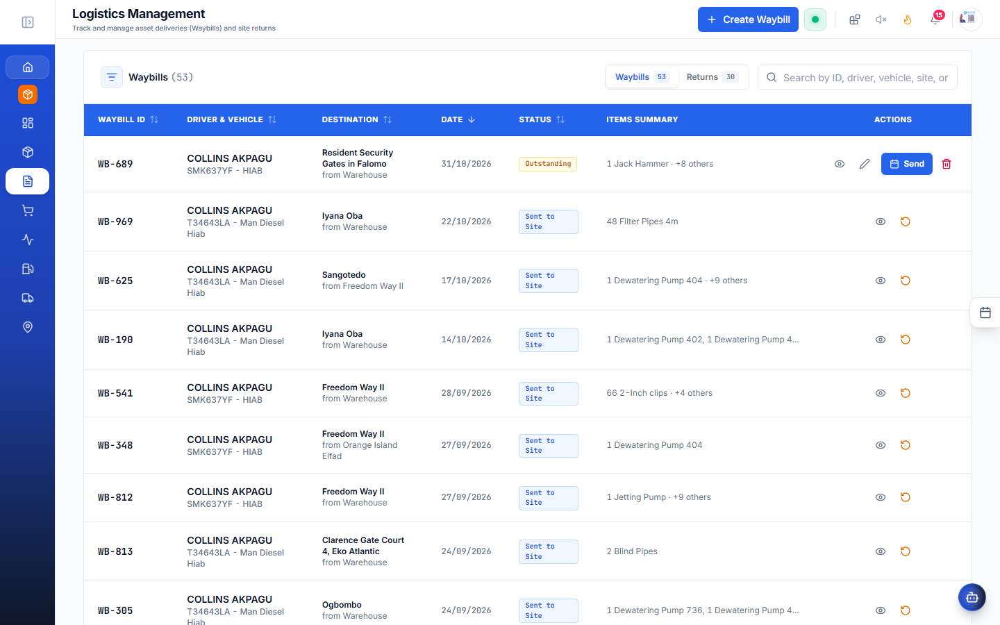
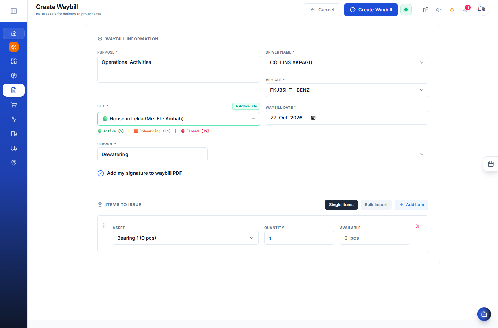
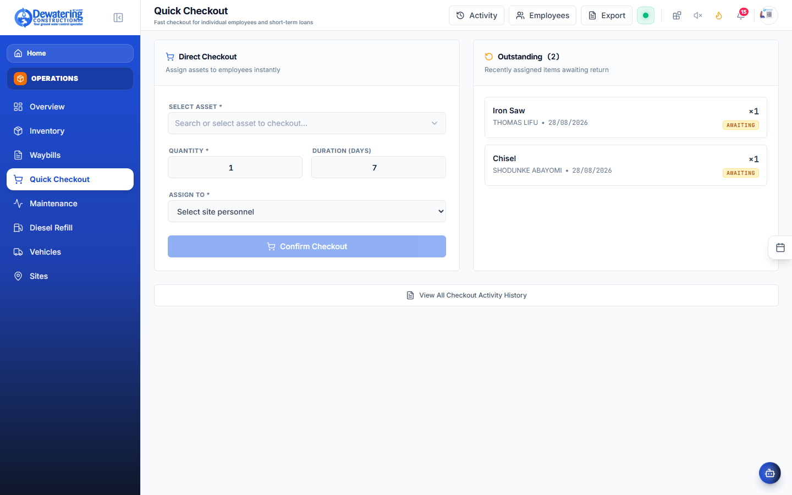
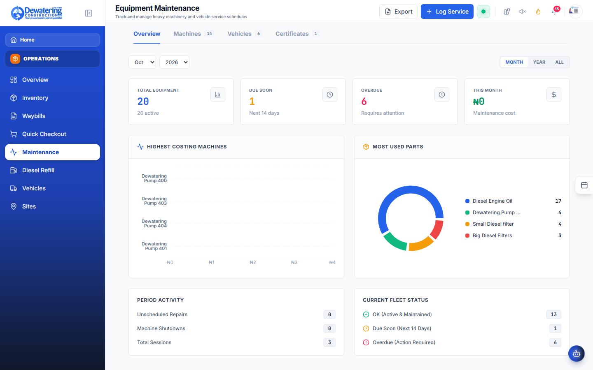
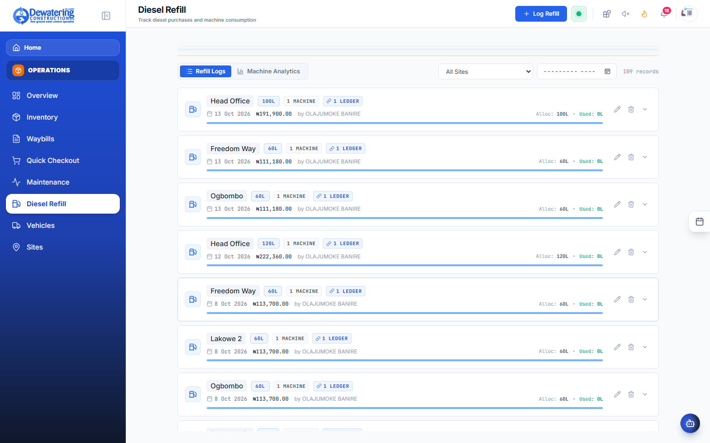
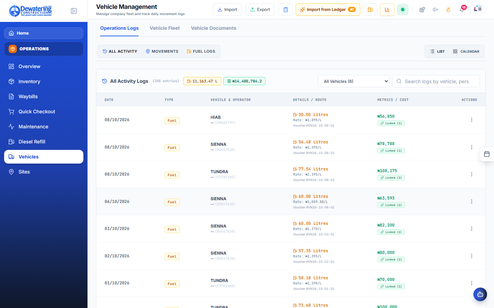

# Chapter 4: Operations, Machinery & Diesel Fuel

> **Company:** Dewatering Construction Etc. Limited (DCEL)  
> **Who is this for?** Yard Foremen, Site Supervisors, Logistics Officers, Mechanics, and Drivers  

---

## 4.1 Equipment Inventory & Machine Locations

**Where to go:** In the left menu, click **Operations** ➔ **Inventory** (`/operations/assets`)

Need to know where 6-inch vacuum pump #3 is, or check if an extra 150kVA generator is available in the yard?





```
┌────────────────────────────────────────────────────────────────────────────────────────┐
│ MACHINERY & EQUIPMENT INVENTORY                                                        │
├───────────────┬─────────────────────────┬───────────────┬──────────────┬───────────────┤
│ Asset Tag     │ Machine Description     │ Status        │ Location     │ Service Due   │
├───────────────┼─────────────────────────┼───────────────┼──────────────┼───────────────┤
│ DCEL-PMP-001  │ 6" Sykes Vacuum Pump    │ Active on Site│ Eko Atlantic │ In 120 Hours  │
│ DCEL-PMP-004  │ 6" Godwin CD150M Diesel │ In Yard/Ready │ Central Yard │ Ready         │
│ DCEL-GEN-002  │ 150kVA Perkins GenSet   │ Active on Site│ Dangote Ref. │ In 45 Hours   │
│ DCEL-JET-003  │ High-Pressure Jet Pump  │ In Workshop   │ Yard Workshop│ Under Repair  │
└───────────────┴─────────────────────────┴───────────────┴──────────────┴───────────────┘
```

### What You Can Do Here:
- **Search Any Machine:** Type a machine number (e.g. `PMP-001`) or equipment type into the search bar.
- **Check Status:** See at a glance if a pump is **Available in the Yard**, **Working on Site**, or **Under Maintenance**.
- **Scan Machine QR Code:** Tap the camera icon on your phone to scan the physical QR sticker on any pump. It immediately opens the machine's service history, user handbook, and current project assignment.

---

## 4.2 How to Create a Delivery Waybill (Moving Equipment to Site)

**Where to go:** In the left menu, click **Operations** ➔ **Waybills** (`/operations/waybills`)

Whenever heavy machinery, pipes, suction hoses, or fuel drums leave the central yard for a construction site, you must create an official **Transit Waybill**.


### Official Transit Waybill Creation Screen




### Step-by-Step Instructions:
1. Click **+ Create Waybill**.
2. Select where the items are leaving from (e.g. *Central Yard*) and where they are going (e.g. *Eko Atlantic Site*).
3. Type the truck plate number, driver's name, and driver's mobile phone number.
4. Select the equipment and enter the quantity of pipes, hoses, and accessories being loaded.
5. Sign on the screen with your finger or mouse and click **Issue Waybill**.
6. Print the paper copy to hand to the truck driver.
7. **When the truck arrives on site:** The site engineer opens the waybill on their phone, checks off that all items arrived safely, and signs the receiving box. The machine's location updates automatically!

---

## 4.3 Borrowing Tools from the Yard (Quick Checkout)

**Where to go:** In the left menu, click **Operations** ➔ **Quick Checkout** (`/operations/checkout`)

When a technician needs a pipe wrench, safety harness, angle grinder, or pressure gauge:



1. Tap **Quick Checkout** on the phone or store tablet.
2. Scan the technician’s staff ID badge or type their name.
3. Scan the barcode on the tool.
4. Tap **Done**. The tool is assigned to that technician until returned, preventing lost tools.

---

## 4.4 Machine Servicing & Oil Changes (Maintenance)

**Where to go:** In the left menu, click **Operations** ➔ **Maintenance** (`/operations/maintenance`)

Dewatering pumps and generators run 24 hours a day. Missing an oil change causes catastrophic engine failure.



### How Service Alerts Work:
- Every time a site supervisor logs daily operating hours, the app counts down to the next service (every 250 hours for diesel engine oil and filters).
- When a machine reaches 250 hours, an orange **"Service Due"** alert appears on the Operations dashboard.

### How a Mechanic Fills a Service Work Order:
1. Open the machine's maintenance card.
2. Check off the completed tasks:
   - *Engine oil drained and refilled (15W-40)*
   - *New primary and secondary fuel filters installed*
   - *Vacuum pump priming belt tension checked*
   - *Water pump impeller inspected*
3. Type any notes (e.g. "Replaced worn rubber seal on pump head").
4. Click **Complete Service & Reset Counter**. The machine is certified safe to run for another 250 hours.

---

## 4.5 Logging Daily Diesel Fuel & Operating Hours

**Where to go:** In the left menu, click **Operations** ➔ **Diesel Refill** (`/operations/diesel`)

Diesel is the biggest daily cost on construction sites. Supervisors must record fuel usage every morning.



```
┌─────────────────────────────────────────────────────────────┐
│                 DAILY DIESEL & HOURS LOG                    │
├─────────────────────────────────────────────────────────────┤
│  Site:          [ Eko Atlantic Site                  ▼ ]    │
│  Equipment:     [ DCEL-PMP-001 (6" Sykes Pump)       ▼ ]    │
│  Date:          [ Today, Oct 27, 2026 ]                     │
│                                                             │
│  Hours Run Today:       [ 24 Hours ]                        │
│  Diesel Added Today:    [ 180 Liters ]                      │
│  Meter Reading:         [ 3,420 Hours ]                     │
│                                                             │
│                   [ Save Fuel Entry ]                       │
└─────────────────────────────────────────────────────────────┘
```

### Steps to Log Fuel:
1. Select your **Site** and choose the **Machine**.
2. Type in how many **Hours** the machine ran over the last 24 hours.
3. Type in how many **Liters of Diesel** were poured into its tank.
4. Click **Save Fuel Entry**.

> [!NOTE]
> **High Fuel Warning:** The system automatically checks how many liters the machine burned per hour. If a 6-inch pump normally burns 7.5 Liters/Hour and suddenly logs 14 Liters/Hour, the screen shows a yellow warning to alert the supervisor to check for fuel leaks or theft.

---

## 4.6 Fleet Vehicles & Inspections

**Where to go:** In the left menu, click **Operations** ➔ **Vehicles** (`/operations/vehicles`)

Keep company pickups, haulage trucks, and staff buses roadworthy and compliant:



- **Paperwork Expiry Alerts:** The app reminds you 30 days before vehicle roadworthiness, state permits, or insurance policies expire.
- **Driver Assignments:** View who is currently responsible for each vehicle.
