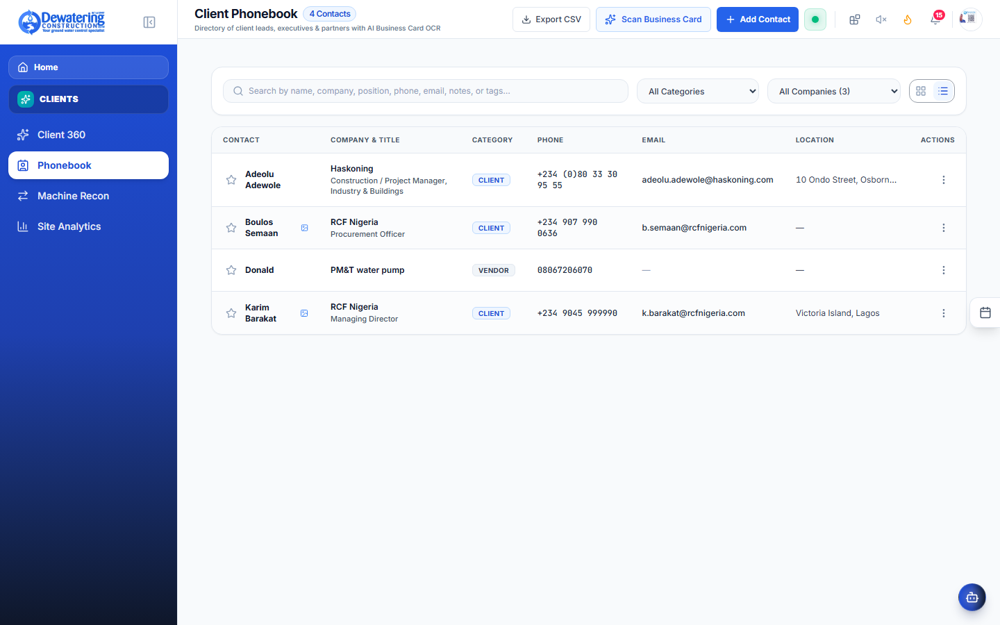
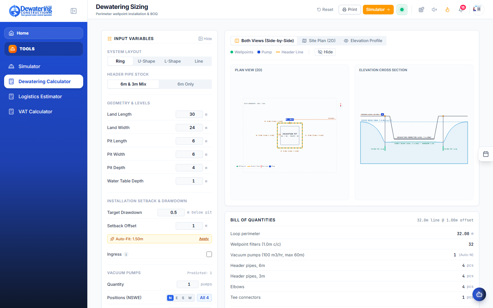

# Chapter 5: Clients, Site Diaries & DewaterCAD

> **Company:** Dewatering Construction Etc. Limited (DCEL)  
> **Who is this for?** Site Engineers, Project Managers, and Geotechnical Field Staff  

---

## 5.1 Client 360: All Client Information in One Place

**Where to go:** In the left menu, click **Clients** ➔ **Client 360** (`/client-360`)

When a client calls or when you are preparing for a site meeting:


1. Select any client company from the list (e.g. *Julius Berger*, *Dangote*, *Cappa & D'Alberto*).
2. The screen immediately displays:
   - **Active Job Sites:** Every site where DCEL is currently working for them.
   - **Machines on Hire:** Exactly which pumps and generators are currently running on their projects.
   - **Account Summary:** Total invoices sent, money paid, and any pending balance.
   - **Key Contacts:** Phone numbers and email addresses of their project managers and site consultants.

---

## 5.2 Scanning Paper Business Cards with Your Phone

**Where to go:** In the left menu, click **Clients** ➔ **Phonebook** (`/clients/phonebook`)

When you meet a client engineer, consultant, or subcontractor on site and they give you a paper business card:



1. Open **Phonebook** on your phone.
2. Tap the **Scan Business Card** button.
3. Hold your phone camera over the paper business card.
4. The app automatically reads the card and fills in the contact's Name, Company, Job Title, Phone Number, and Email Address.
5. Tap **Save Contact**. It is now stored in the company directory for everyone to access.

---

## 5.3 Daily Site Diary (The Site Engineer’s Daily Log)

**Where to go:** In the left menu, click **Operations** ➔ **Sites** ➔ Choose your site ➔ Click **Site Diary** (`/sites/diary/:siteId`)

Every construction site must submit a daily engineering log. This protects the company legally and ensures project managers know exactly what happened on site.


```
┌─────────────────────────────────────────────────────────────┐
│ DAILY SITE DIARY — Eko Atlantic Marina Basin                │
├─────────────────────────────────────────────────────────────┤
│ Date: [ 2026-10-27 ]           Weather: [ Sunny / Clear ▼ ] │
│                                                             │
│ GROUNDWATER & EXCAVATION STATUS:                            │
│ • Initial Water Table:  [ -1.20 meters below ground ]       │
│ • Current Water Level:  [ -6.80 meters below ground ]       │
│ • Excavation Depth:     [ -6.50 meters formation level ]    │
│ • Water Flow Condition: [ Dry & Stable Excavation Bottom ]  │
│                                                             │
│ WORK DONE TODAY:                                            │
│ [ 2x 6" pumps operated continuously for 24 hours. Wellpoint │
│   line jetted along southern wall completed today.          │
│   Excavator deepened pit by 1.5m without water boiling. ]   │
│                                                             │
│ SITE PHOTOS: [ + Take / Attach Photo from Phone ]           │
│                                                             │
│                  [ Submit Daily Diary ]                     │
└─────────────────────────────────────────────────────────────┘
```

### Steps to Fill Your Daily Diary:
1. Select the **Weather** (Sunny, Rain, Heavy Downpour, or Flooded).
2. Record the **Water Level** measured with your dip tape.
3. Record the current **Excavation Depth**.
4. Type a short description of the work completed today.
5. Tap **Attach Photo** to take a clear photo of the dry excavation pit or pump installation.
6. Tap **Submit Daily Diary**. The head office management team can review your report immediately.

---

## 5.4 Using the DewaterCAD Simulator & AI Blueprint Tool

**Where to go:** In the left menu, click **Tools** ➔ **Simulator** (`/operations/simulator`)

The DewaterCAD Simulator allows site engineers to plan an entire groundwater dewatering installation on a site drawing before sending a single pipe to the site.


```
┌────────────────────────────────────────────────────────────────────────────────────────┐
│ DewaterCAD Simulator: Eko Atlantic Basin                                  [ 2D / 3D ]  │
├────────────────────────────────────────────────────────────────────────────────────────┤
│ [ + AI Dewatering Assistant ]  [ 📐 Calibrate Scale ]  [ 💾 Export BOM ] [ 🖨️ PDF ]   │
│                                                                                        │
│     ========================================================================           │
│     || [Pump #1] ─── Header Line (Pipes with Filter Points every 1m) ──────┐ ||        │
│     ||                                                                     │ ||        │
│     ||   ┌────────────────────────────────────────────────────────────┐    │ ||        │
│     ||   │               EXCAVATION PIT TO BE DEWATERED               │    │ ||        │
│     ||   │               Formation Depth: -6.50m                      │    │ ||        │
│     ||   │               Target Water Drawdown: -7.00m                │    │ ||        │
│     ||   └────────────────────────────────────────────────────────────┘    │ ||        │
│     ||                                                                     │ ||        │
│     || ═══ VEHICLE INGRESS RAMP (Clear entrance for dump trucks) ──────────┘ ||        │
│     ========================================================================           │
│                                                                                        │
│ SUMMARY: Header: 144m | 6m Pipes: 24 | Pumps: 2x 6" Diesel | 3D View Ready             │
└────────────────────────────────────────────────────────────────────────────────────────┘
```

---

### Step-by-Step: How to Design a Dewatering Layout with AI

#### Step 1: Upload Your Site Drawing
1. Open the simulator and click **AI Dewatering Assistant**.
2. Upload your architectural site drawing, CAD plan, or excavation drawing (as a PNG or JPG picture).

#### Step 2: Set the Scale (Calibrate Measurement)
1. Click the **Calibrate Scale** tool.
2. Click on two grid lines or structural building columns on the drawing where you know the real distance.
3. Type in the real distance in meters (for example: `25 meters`). The software now knows the exact real-world dimensions of the drawing.

#### Step 3: Trace Your Excavation Pit
1. Click the **Trace Pit** tool.
2. Click on each corner of your excavation pit on the drawing to outline the hole.
3. Double-click the last corner to close the shape. The app shows you the exact length around the pit (perimeter) and square meters (area).

#### Step 4: Choose Your Site Settings
Fill in a few simple questions:
- **How deep is the excavation?** (e.g. `-6.5 meters`).
- **Where is the natural ground water?** (e.g. `-1.2 meters`).
- **Which side will trucks drive into the pit?** Select North, South, East, or West, and set the ramp width (e.g. `6 meters`). The software will make sure no pipes or pumps block the truck entrance ramp!
- **Pipe Size:** Choose `6m Modular Pipes`.

#### Step 5: Click Generate Layout!
Click the blue **Generate Dewatering Blueprint** button:
- The app automatically places header pipes all the way around your excavation.
- It inserts wellpoint riser pipes every 1 meter.
- It places 6-inch diesel vacuum pumps in safe spots away from the truck ramp.
- It runs discharge hoses to your water disposal channel.
- Click **3D View** to rotate and look at your deep excavation in realistic 3D!

#### Step 6: Export Your Pipe & Pump List (BOM)
Click **Export Bill of Materials (BOM)**:
- The app instantly gives you an exact count:
  - *24 pieces of 6-meter header pipes*
  - *48 wellpoint risers and filters*
  - *2 Sykes 6-inch diesel pumps*
  - *Couplings, bends, and layflat discharge hoses*
- Click **Send to Waybill** to immediately pass this list to the Yard Foreman so they can load the delivery truck!

---

## 5.5 Quick Dewatering & Logistics Calculators

### 1. Water Flow Calculator (`/operations/dewatering-calculator`)



Select your soil type (Sand, Gravel, or Clay), type your excavation depth, and the calculator tells you how many cubic meters of water per hour the pumps must discharge to keep the excavation dry.

### 2. Haulage & Logistics Estimator (`/operations/estimator`)
Type the distance to the job site (e.g. `120 km`), choose how many flatbed trucks and cranes are needed, and the app calculates the total transport cost and diesel fuel needed for mobilization.
