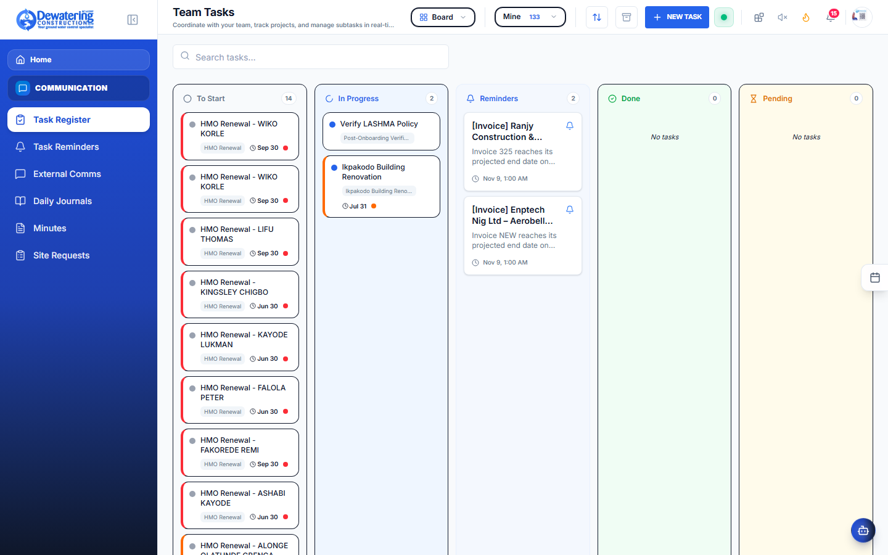
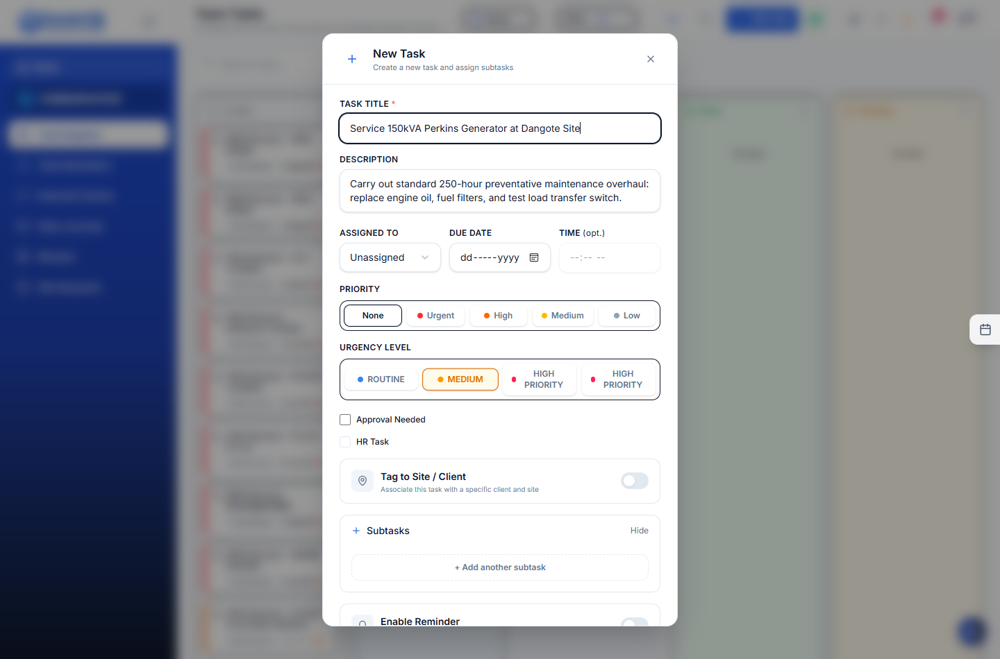
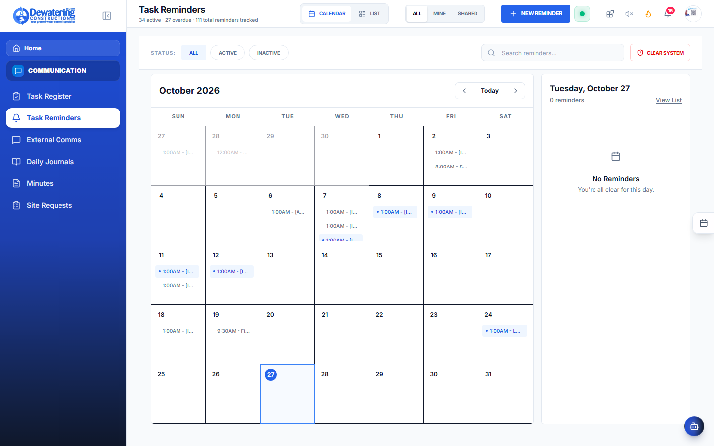
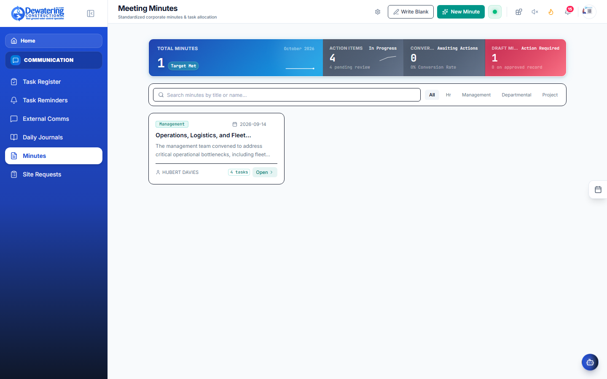
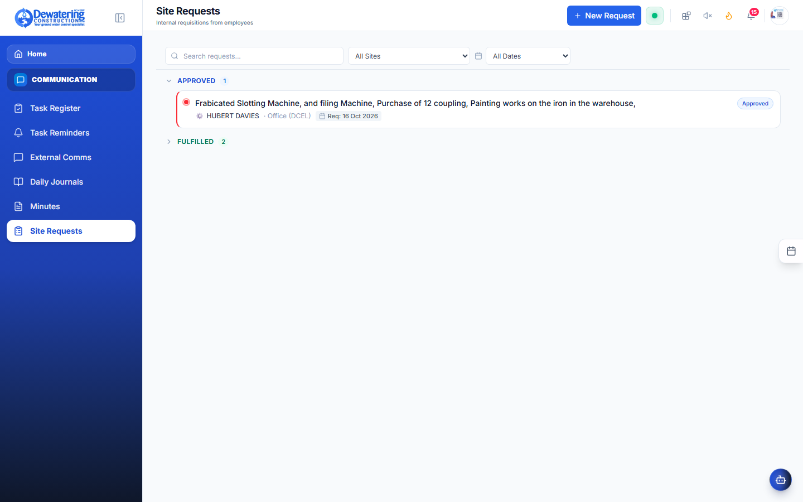
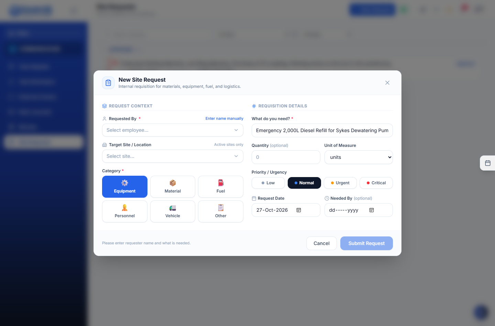

# Chapter 6: Tasks, Team Chat & Meeting Minutes

> **Company:** Dewatering Construction Etc. Limited (DCEL)  
> **Who is this for?** All Staff, Project Managers, Supervisors, and Meeting Secretaries  

---

### 6.1 Managing Daily Work & Tasks

**Where to go:** In the left menu, click **Communication** ➔ **Task Register** (`/tasks`)

The Task Register keeps everyone on the same page regarding machine repairs, site surveys, payroll deadlines, and client meetings.



### Task Creation & Delegation Dialog




### How to Create a New Task:
1. Click the blue **+ Create Task** button.
2. Type a clear title (e.g. *"Service 150kVA Generator at Dangote Site"*).
3. Select the **Department** and choose the worker in **Assigned To**.
4. Set the **Due Date** and **Priority** (High, Medium, or Low).
5. Add subtasks if needed (e.g., *1. Drain oil, 2. Fit new filter, 3. Test run*).
6. Click **Save Task**. The assigned worker will get an instant alert on their phone and computer.

### Checking Off Subtasks & Completing Work:
- As you complete each step, click its checkbox. The progress bar moves forward (e.g. `2 of 3 Completed - 67%`).
- When all work is done, change the status to **Completed**.

> [!NOTE]
> **Why is a task marked "Pending Approval"?**  
> Sensitive actions (such as spending company money or decommissioning machinery) require a manager to review and approve the task before it can be closed.

---

## 6.2 Chatting on Tasks (WhatsApp-Style Messages)

No more lost messages in personal WhatsApp groups! Every task has its own built-in conversation feed.

```
┌─────────────────────────────────────────────────────────────┐
│ TASK: Overhaul Sykes 6" Pump #004                           │
├─────────────────────────────────────────────────────────────┤
│                                                             │
│   [Tunde Adebayo - 10:14 AM]                                │
│   ┌──────────────────────────────────────────────────────┐  │
│   │ I have opened the pump head. The impeller is worn out│  │
│   │ and needs replacement before we test run.            │  │
│   └──────────────────────────────────────────────────────┘  │
│                                                             │
│                [Head of Operations - 10:22 AM]              │
│                ┌─────────────────────────────────────────┐  │
│                │ Approved. Collect a new 6" impeller     │  │
│                │ from Central Yard Stores Tag #IMP-012.  │  │
│                └─────────────────────────────────────────┘  │
│                                                             │
│   [ 📷 Take / Attach Photo ]  [ Type your message... ]  [▶] │
│└─────────────────────────────────────────────────────────────┘
```

1. Click on any task to open its details.
2. Scroll to the bottom to see the chat timeline.
3. Type an update or tap the **Camera** icon to attach a photo of a broken part or completed work.
4. Tap the **Send** arrow (`▶`). Everyone assigned to the task sees your message immediately.

---

## 6.3 Setting Pop-Up Reminders

**Where to go:** In the left menu, click **Communication** ➔ **Task Reminders** (`/tasks/reminders`)

Have an important deadline coming up, such as submitting attendance by 4:00 PM or renewing truck insurance?



1. Click **+ Add Reminder**.
2. Type what you need to remember.
3. Pick the exact date and time.
4. When the time arrives, a reminder card will pop up on your screen. You can click **Go to Task** to take action or click **Snooze (1 hour)** to be reminded again later.

---

## 6.4 Recording Meeting Minutes & Signing Digitally

**Where to go:** In the left menu, click **Communication** ➔ **Minutes** (`/minutes`)

Keep professional records of weekly management meetings, site safety toolbox meetings, or client progress discussions:



1. Click **+ New Meeting Minutes**.
2. Type the meeting title, date, and location.
3. Select which workers were present.
4. Type the discussion notes and decisions made.
5. In the **Action Items** table, list specific jobs assigned during the meeting, who is responsible, and the deadline.
6. **Sign On Screen:** The meeting chairman and secretary can sign directly on the screen with their finger or mouse.
7. Click **Generate PDF** to print or email the official meeting minutes to everyone.

---

## 6.5 Requesting Emergency Cash, Diesel or Tools from Site

**Where to go:** In the left menu, click **Communication** ➔ **Site Requests** (`/operations/site-requests`)

When a site engineer runs out of fuel or urgently needs spare fittings:



### New Site Requisition Modal




1. Click **+ New Request**.
2. Choose your site.
3. Select what you need: **Cash**, **Diesel**, **Spare Parts**, or **Tools**.
4. Type the explanation (e.g. *"Emergency 500L diesel needed for continuous night pumping during heavy rain"*).
5. Click **Submit Requisition**.
6. The Operations and Finance managers review the request on their screen and click **Approve** for immediate disbursement.
