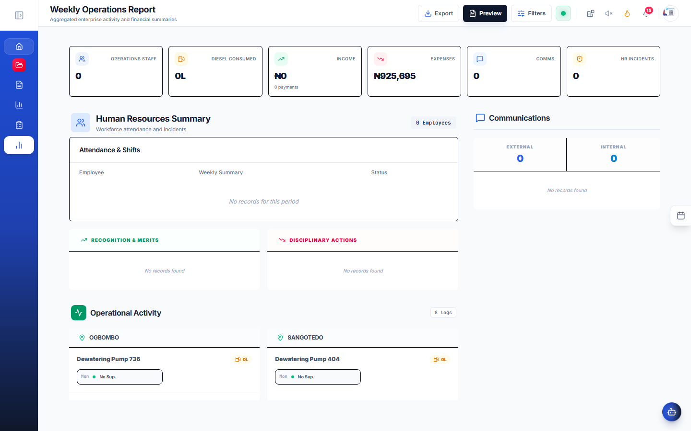
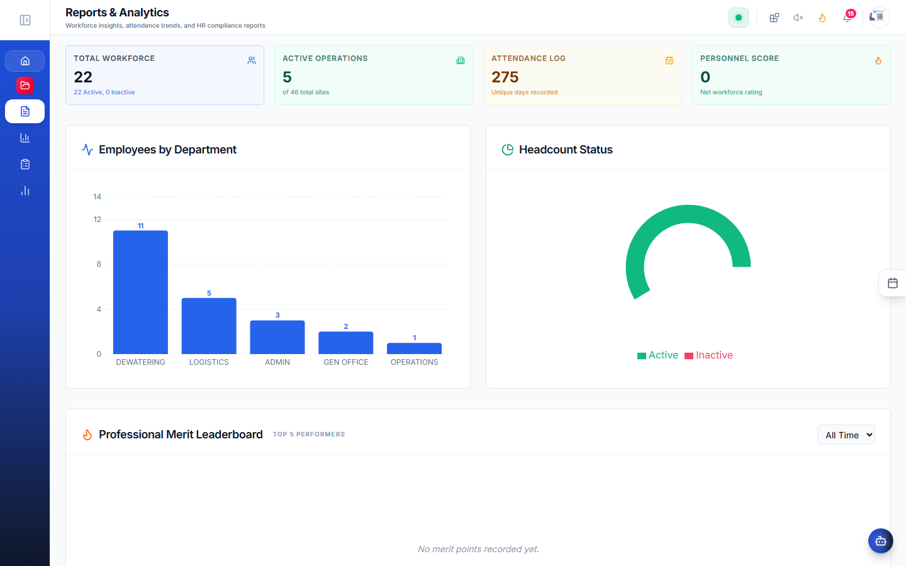
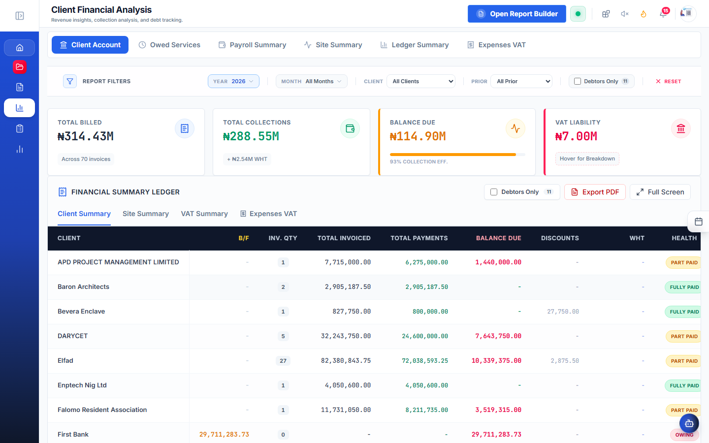
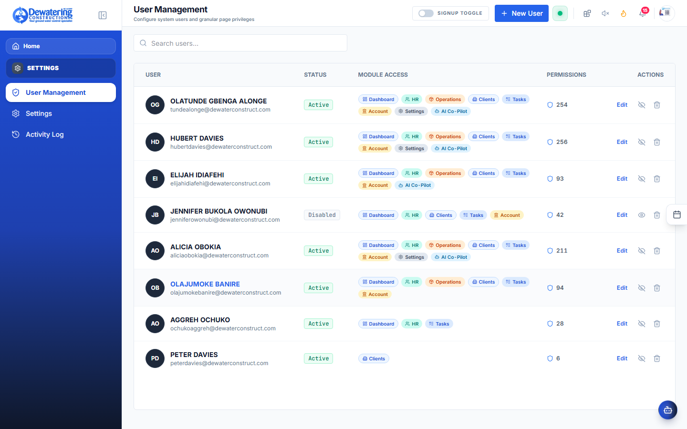
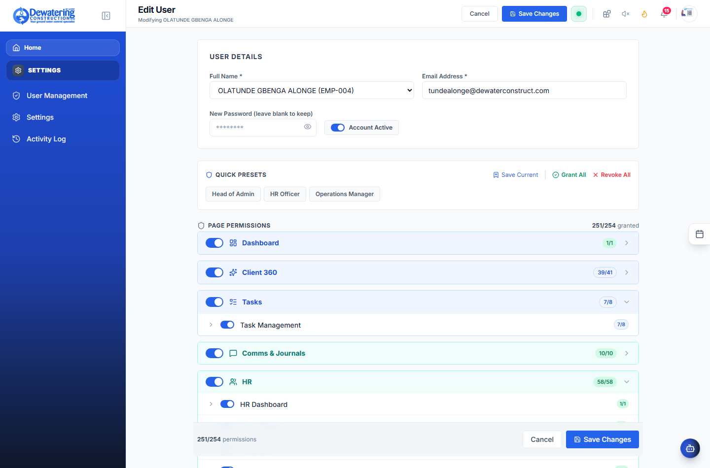
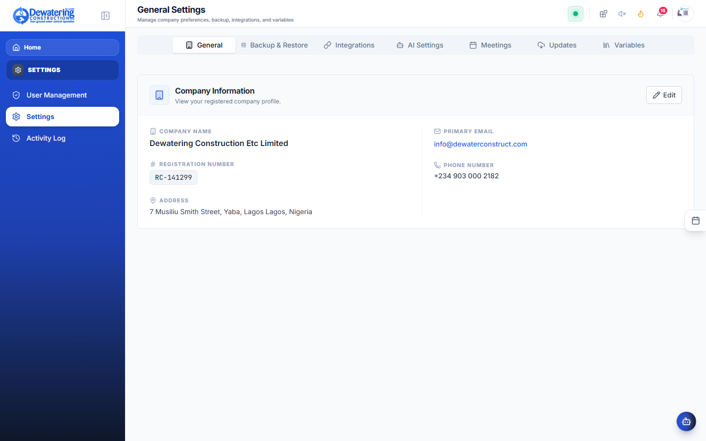
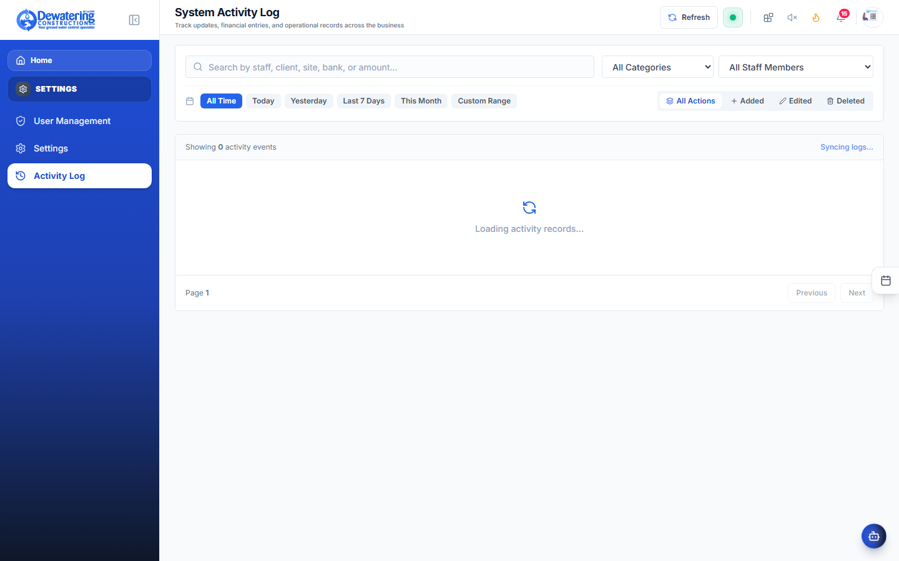

# Chapter 7: Reports, User Accounts & Settings

> **Company:** Dewatering Construction Etc. Limited (DCEL)  
> **Who is this for?** Managing Directors, Department Leads, and Office Administrators  

---

## 7.1 The Monday Morning Executive Weekly Report

**Where to go:** In the left menu, click **Reports** ➔ **Weekly Report** (`/weekly-report`)

Designed specifically for the Managing Director and Department Heads for their Monday morning review:



```
┌────────────────────────────────────────────────────────────────────────────────────────┐
│ DCEL OFFICE SUITE — EXECUTIVE WEEKLY SUMMARY: WEEK 43 (October 2026)                   │
├────────────────────────────────────────────────────────────────────────────────────────┤
│ 1. OPERATIONS & SITE SITES:                                                            │
│    • Total Active Sites: 6 (Eko Atlantic, Lekki Phase 1, Dangote, Victoria Island)     │
│    • Total Machine Run-Hours Logged: 1,840 Hours (94.2% Fleet Availability)            │
│    • Diesel Consumed: 14,200 Liters (Average 7.7 L/h per active pump)                  │
│                                                                                        │
│ 2. COMMERCIAL & MONEY INFLOW:                                                          │
│    • Invoices Issued This Week: ₦ 18,500,000.00                                        │
│    • Client Payments Received:  ₦ 12,200,000.00                                        │
│    • Pending Client Receivables:₦ 46,300,000.00                                        │
│                                                                                        │
│ 3. WORKFORCE & SAFETY:                                                                 │
│    • Total Field Staff: 84 Workers                                                     │
│    • Overtime Shifts: 18 Shifts (Sunday emergency foundation pour)                     │
│    • Safety Record: Zero Accidents or Lost Time Incidents                              │
├────────────────────────────────────────────────────────────────────────────────────────┤
│ [ Print Executive Summary PDF ]                      [ Send to Directors by Email ]    │
└────────────────────────────────────────────────────────────────────────────────────────┘
```

- Simply click **Print Executive Summary** to print a clean paper copy or click **Send to Directors** to email the report.

---

## 7.2 Human Resources & Financial Reports

### 1. HR Reports (`/reports`)



- **Monthly Attendance Report:** Print a clean spreadsheet showing the exact days every worker reported to work.
- **Leave Balance Report:** Check how many vacation days each worker has left before the year ends.

### 2. Financial Reports (`/financial-reports`)



- **Revenue by Client:** See which clients and projects generated the most billing this month or this quarter.
- **Overdue Invoices:** A list of clients who have not yet paid their bills, including the number of days overdue (30 days, 60 days, 90+ days).
- **Custom Report Builder:** Pick your own columns (such as *Client Name*, *Machine Tag*, *Liters of Diesel Used*, *Total Cost*) and click **Export to Excel**.

---

## 7.3 Managing User Accounts & Access Rights

**Where to go:** In the left menu, click **Settings** ➔ **User Management** (`/users`)

As an administrator, you control who can access the app and which screens each person can see:


### Comprehensive User Permissions Editor




### How to Create a New User Account:
1. Click **+ Add User**.
2. Type the employee's name and work email address.
3. Set an initial password for them.
4. **Choose their permissions:** Check the boxes for the departments they need. For example:
   - *Site Engineers:* Check **Sites**, **Tools**, and **Communication**.
   - *Accountants:* Check **Accounts**, **Payroll**, and **Reports**.
5. Click **Save User**.

### How to Deactivate an Account When an Employee Leaves:
1. Open their user profile.
2. Uncheck the **Active Account** box.
3. Click **Save**. The user is immediately logged out and can no longer sign in.

---

## 7.4 Company Settings & Operational Variables

**Where to go:** In the left menu, click **Settings** ➔ **System Settings** (`/settings`)

Manage corporate parameters, business tax rates, and default workday rules:



- **Corporate Details:** Official headquarters address, support phone lines, and billing entity details.
- **Tax & Pension Defaults:** Standard 7.5% VAT, 5% WHT, and 8% statutory employee pension rates.
- **Calendar & Shift Standards:** Standard official monthly workdays (22 days) and site overtime calculation multipliers.

---

## 7.5 Checking the Activity History (Who Changed What?)

**Where to go:** In the left menu, click **Settings** ➔ **Activity Log** (`/activity-log`)

Need to know who approved a payment, who edited an attendance record, or when a waybill was issued?



- The Activity Log shows every action with the exact time, the name of the worker who did it, and what was changed.
- Records in this log cannot be altered or erased by anyone, protecting the company and keeping everyone honest.
